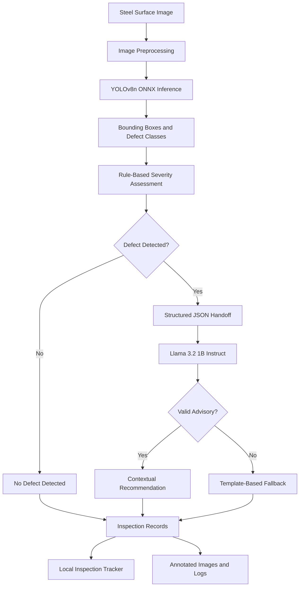

# EdgeSteel — Bharat AI SoC 2026–27

### ARM-Based Offline Steel Surface Defect Detection and Intelligent Inspection

**Edge AI | Industrial Quality Control | Computer Vision | On-Device Generative AI**

EdgeSteel is an offline, edge-deployed steel surface inspection and intelligent quality-control assistance system implemented on the NVIDIA Jetson Orin Nano platform.

The system integrates a lightweight YOLOv8n object detector, rule-based defect severity assessment, an on-device quantized Llama 3.2 1B Instruct language model, and a local inspection tracker to provide defect localization, contextual explanations, and actionable operator recommendations without requiring cloud connectivity.

---

## 1. Project Overview

| Parameter | Description |
|---|---|
| Competition | Bharat AI SoC 2026–27 |
| Problem Statement | Real-time industrial defect detection and quality-control assistant |
| Project Name | EdgeSteel |
| Application | Steel surface defect detection |
| Target Platform | NVIDIA Jetson Orin Nano |
| Vision Model | YOLOv8n |
| Language Model | Llama 3.2 1B Instruct |
| Vision Runtime | ONNX Runtime |
| Language Model Runtime | ExecuTorch with XNNPACK |
| Deployment | Offline edge inference |
| Institution | BITS Pilani, Hyderabad Campus |

---

## 2. Problem Statement

Steel manufacturing processes such as rolling, casting, machining, and surface finishing can introduce defects that affect product quality, structural integrity, and suitability for subsequent processing.

Conventional manual inspection is susceptible to operator fatigue, inconsistent assessment, variable lighting conditions, and limitations in inspection speed.

EdgeSteel addresses these challenges through an integrated edge AI framework that detects and localizes surface defects, evaluates their severity, and generates contextual inspection recommendations locally on an ARM-based computing platform.

The objective is to support industrial quality-control operators while reducing dependence on cloud infrastructure and remote processing.

---

## 3. Key Features

- Six-class steel surface defect detection and localization.
- Lightweight YOLOv8n architecture optimized for edge deployment.
- ONNX-based vision inference with CUDA execution support.
- Rule-based defect severity assessment.
- Spatial localization using image coordinates and inspection zones.
- Quantized on-device Llama language model.
- Contextual defect explanations and operator recommendations.
- Deterministic template fallback for unreliable language-model responses.
- Conditional advisory generation for detected defects.
- Offline operation without cloud inference.
- Local inspection records and annotated image storage.
- Flask-based inspection tracker.
- Hardware benchmarking for latency, throughput, memory, and power consumption.
- Exploratory evaluation using steel surface photographs collected at the BITS Pilani Hyderabad Central Workshop.

---

## 4. System Architecture



The architecture separates time-sensitive visual inspection from the computationally more expensive language-model advisory stage.

This separation allows the vision subsystem to achieve high processing throughput while generating contextual recommendations when required.

---

## 5. Dataset

### 5.1 Primary Dataset

The Northeastern University Surface Defect Detection dataset (NEU-DET) was used for supervised training and evaluation of the object detection model.

| Dataset Parameter | Specification |
|---|---|
| Dataset | NEU-DET |
| Total Images | 1,800 |
| Number of Classes | 6 |
| Original Resolution | 200 × 200 pixels |
| Image Type | Grayscale steel surface images |
| Annotation Type | Object detection bounding boxes |
| Initial Training Resolution | 416 × 416 pixels |

### 5.2 Defect Categories

| Class | Description |
|---|---|
| Crazing | Fine, irregular surface crack patterns |
| Inclusion | Foreign material or embedded impurities |
| Patches | Localized regions of abnormal surface appearance |
| Pitted Surface | Small depressions or cavities on the surface |
| Rolled-in Scale | Oxide scale embedded during rolling |
| Scratches | Linear mechanical surface marks |

### 5.3 Dataset Partitioning

Initial model-development experiments used the following partition:

| Subset | Images | Percentage |
|---|---:|---:|
| Training | 1,440 | 80% |
| Validation | 180 | 10% |
| Testing | 180 | 10% |

The final detector benchmark reports an 85% training and 15% validation split using random seed 42, without a separate internal test split.

Results from these evaluation configurations are reported separately and should not be interpreted as directly equivalent test-set measurements.

### 5.4 Image Preprocessing

The preprocessing workflow includes:

- Image preparation and resizing.
- Bounding-box annotation conversion to YOLO format.
- Dataset organization and class mapping.
- Training and validation partitioning.
- Geometric data augmentation.
- Input tensor preparation for model inference.

---

## 6. Object Detection Model Development

### 6.1 Model Selection

YOLOv8n was selected as the primary object detection architecture because of its compact design and suitability for resource-constrained edge inference.

The model simultaneously predicts defect classes, bounding-box coordinates, and detection confidence scores.

### 6.2 Model Architecture

The YOLOv8n architecture consists of three principal components:

- **Backbone:** Extracts hierarchical visual features using convolutional layers and C2f modules.
- **Neck:** Aggregates multiscale features to support the detection of defects of different sizes.
- **Detection Head:** Predicts bounding boxes and defect classes using an anchor-free detection mechanism.

The trained PyTorch model was subsequently exported to ONNX format for deployment on the Jetson platform.

### 6.3 Initial Model Optimization

Initial baseline and hyperparameter-tuned experiments produced the following results:

| Metric | Baseline | Tuned Model |
|---|---:|---:|
| Precision | 75.51% | 69.15% |
| Recall | 56.28% | 70.17% |
| mAP@50 | 65.89% | 74.12% |
| mAP@50–95 | 35.16% | 42.65% |

The tuned model improved recall and mean average precision, although precision decreased relative to the initial baseline.

### 6.4 Data Augmentation Experiments

Further experiments investigated individual and combined augmentation configurations.

| Experiment | mAP@50 | mAP@50–95 |
|---|---:|---:|
| Augmentation Baseline | 70.08% | 35.30% |
| Scaling (0.2) | 74.65% | 41.19% |
| Translation (0.05) | 74.13% | 40.78% |
| Mosaic (0.5) | 74.30% | 40.19% |
| Combined Augmentation | **80.90%** | **50.80%** |

The combined augmentation configuration achieved the highest reported mean average precision among these experiments.

Crazing and rolled-in scale remained challenging categories, indicating opportunities for further class-specific optimization.

### 6.5 Final Detector Validation

The final deployment benchmark records the following detector validation metrics:

| Metric | Value |
|---|---:|
| mAP@50 | **80.88%** |
| mAP@50–95 | **50.87%** |
| Macro Precision | 73.77% |
| Macro Recall | 76.34% |
| Macro F1-score | 73.51% |
| Deployment Confidence Threshold | 0.268 |

These values represent detector validation performance recorded in the deployment benchmark. They do not represent independently measured accuracy on the Central Workshop photographs.

---

## 7. Rule-Based Severity Assessment

The detected bounding boxes and class predictions are processed by a deterministic severity assessment module.

The assessment incorporates detection characteristics and spatial information to assign inspection-level severity.

### Severity Categories

| Severity | Interpretation |
|---|---|
| None | No defect detected above the configured threshold |
| Low | Lower-priority defect requiring routine review |
| Medium | Defect requiring further inspection |
| High | Higher-priority defect requiring operator attention |

The assessment considers factors such as:

- Defect category.
- Detection confidence.
- Bounding-box dimensions and relative area.
- Number of detected defects.
- Spatial location within the image.
- Proximity to the strip edge.

The severity configuration is maintained in `severity_config.json`, allowing the assessment rules to be adjusted independently of the trained detector.

The severity thresholds are engineering design assumptions and have not been certified against industrial acceptance standards.

---

## 8. On-Device Language Model

### 8.1 Model Configuration

| Parameter | Specification |
|---|---|
| Model | Llama 3.2 1B Instruct |
| Quantization | 8da4w |
| Activation Quantization | 8-bit dynamic |
| Weight Quantization | 4-bit |
| Runtime | ExecuTorch |
| Backend | XNNPACK CPU |
| Deployment Format | `.pte` |
| Temperature | 0.2 |
| Maximum New Tokens | 110 |

The language model receives structured defect information rather than directly processing the input image.

### 8.2 Structured Information Handoff

The vision and severity assessment stages provide structured information to the advisory module, including:

- Detected defect class.
- Severity category.
- Detection confidence.
- Relative defect area.
- Spatial location and inspection zone.
- Strip-edge proximity.
- Detected defect count.

The language model converts this information into human-readable contextual explanations and suggested inspection actions.

### 8.3 Conditional Advisory Generation

When no defect is detected, the system records the result without invoking the language model.

When defects are detected, the structured inspection information is passed to the advisory module.

This approach avoids unnecessary language-model computation for images without detected defects.

### 8.4 Template-Based Fallback

The generated response is checked against the expected structured output format.

If the response cannot be used, a deterministic template-based advisory is generated instead.

The fallback mechanism improves operational continuity and prevents malformed language-model responses from interrupting the inspection workflow.

All recommendations are intended to assist human operators rather than autonomously authorize production or product acceptance.

---

## 9. Hardware Deployment

### 9.1 Hardware and Software Configuration

| Component | Specification |
|---|---|
| Hardware | NVIDIA Jetson Orin Nano Developer Kit |
| Processor Architecture | ARM64 / aarch64 |
| GPU Architecture | NVIDIA Ampere |
| Jetson Linux Release | R36.5.2 |
| Benchmark Power Mode | 25 W |
| Python Version | 3.10.12 |
| Vision Execution Providers | CUDA and CPU |
| Language Model Backend | XNNPACK CPU |
| User Interface | Flask-based local tracker |
| Hardware Monitoring | NVIDIA tegrastats |

The hardware benchmark identifies the configured system as an NVIDIA Jetson Orin Nano Engineering Reference Developer Kit Super.

### 9.2 Deployment Workflow

1. Train and optimize the YOLOv8n detector.
2. Export the selected model to ONNX.
3. Prepare the quantized Llama model using ExecuTorch.
4. Configure the Jetson hardware and software environment.
5. Install the required Python dependencies.
6. Build the language-model inference runner.
7. Transfer model assets and configuration files.
8. Execute the vision and advisory pipeline locally.
9. Store annotated images and structured inspection records.
10. Execute hardware benchmarking and display results through the tracker.

The demonstrated inference workflow operates locally using stored steel surface images.

---

## 10. On-Device Benchmark Results

### 10.1 Vision Performance

The vision subsystem was benchmarked using 200 timed image inputs.

| Metric | Result |
|---|---:|
| Images Timed | 200 |
| Vision Throughput | **37.12 FPS** |
| Throughput at P95 Latency | 23.76 FPS |
| Mean Vision Latency | **26.938 ms** |
| Median Vision Latency | 24.741 ms |
| P95 Vision Latency | 42.059 ms |
| Minimum Vision Latency | 17.725 ms |
| Maximum Vision Latency | 61.988 ms |

### 10.2 Stage-Wise Processing Latency

| Processing Stage | Mean Latency | P95 Latency |
|---|---:|---:|
| Preprocessing | 5.28 ms | 10.04 ms |
| Model Inference | 20.09 ms | 34.29 ms |
| Postprocessing | 1.18 ms | 2.04 ms |
| Severity Assessment | 0.39 ms | 0.72 ms |
| Total Vision Pipeline | **26.94 ms** | **42.06 ms** |

Model inference represents the largest component of vision processing latency.

### 10.3 Vision Power and Memory Consumption

| Metric | Result |
|---|---:|
| Mean Active Power | 8.057 W |
| Peak Active Power | 8.584 W |
| Mean Idle Power | 5.210 W |
| Peak Idle Power | 5.910 W |
| Mean Whole-Board RAM Usage | 4,622.9 MB |
| Peak Whole-Board RAM Usage | 4,627 MB |
| Python Process RSS | 916.6 MB |

Power and memory values were recorded using the available hardware-monitoring and process-level measurements.

The active power measurement should not be interpreted as the configured 25 W power-mode limit.

### 10.4 Language Model Performance

The language-model benchmark consisted of eight advisory calls.

| Metric | Result |
|---|---:|
| Advisory Calls | 8 |
| Template Fallback Calls | 3 |
| Mean Model Loading Time | 3.898 s |
| Mean Time to First Token | 5.500 s |
| P95 Time to First Token | 5.887 s |
| Mean Prefill Throughput | 48.131 tokens/s |
| Mean Decode Throughput | **12.58 tokens/s** |
| Mean Total Response Time | 21.123 s |
| P95 Total Response Time | 35.372 s |
| Runner Peak RSS | 1,172.3 MB |
| Peak Whole-Board RAM Usage | 5,427 MB |
| Mean Active Power | 7.260 W |
| Peak Active Power | 8.346 W |

The language-model stage is considerably slower than the vision subsystem. Consequently, the measured vision throughput should not be interpreted as the throughput of the complete vision-plus-advisory workflow.

---

## 11. Industrial Throughput Assessment

A theoretical steel-strip inspection scenario was considered to evaluate the suitability of the vision subsystem for continuous inspection.

### Assumed Operating Conditions

| Parameter | Assumed Value |
|---|---:|
| Steel Strip Speed | 1.0 m/s |
| Physical Strip Length Covered per Crop | 0.20 m |
| Required Inspection Throughput | 5 FPS |

The required inspection rate is calculated as:

```text
Required FPS = Strip Speed / Physical Crop Coverage

Required FPS = 1.0 / 0.20

Required FPS = 5 FPS
```

### Performance Comparison

| Parameter | Throughput |
|---|---:|
| Theoretical Requirement | 5 FPS |
| Measured Vision Throughput | 37.12 FPS |
| Throughput at P95 Latency | 23.76 FPS |

The measured vision throughput exceeds the assumed requirement by approximately 7.42 times, while throughput at P95 latency exceeds it by approximately 4.75 times.

These results indicate potential suitability for the assumed inspection scenario.

The assessment is theoretical and does not constitute validation on an operational industrial conveyor. Camera acquisition, illumination, image overlap, communication delays, and production-line integration require further evaluation.

---

## 12. External Image Evaluation

To investigate model behaviour beyond the primary dataset, steel surface photographs were collected by the project team at the Central Workshop, BITS Pilani Hyderabad Campus.

The photographs were processed into image crops suitable for the deployed inspection pipeline.

The evaluation demonstrated:

- Processing of locally acquired steel surface images.
- Defect localization on previously unseen workshop photographs.
- Detection of scratches, inclusions, and patches in selected images.
- Assignment of inspection-level severity.
- Generation of contextual operator recommendations.
- Storage of annotated images and inspection records.

The external photographs exhibit variations in illumination, surface texture, reflection, and machining characteristics compared with NEU-DET.

This evaluation is exploratory and qualitative. The workshop photographs do not constitute an independently annotated and quantitatively validated external test set.

A result of "no defect detected" does not establish that the photographed surface is defect-free.

---

## 13. Steel Defect Tracker

A local Flask-based application provides an interface for reviewing inspection records and benchmark results.

### Tracker Components

| Interface | Function |
|---|---|
| Overview | Inspection summaries and system information |
| Inspections | Individual inspection records |
| Benchmark | Detector and hardware performance metrics |
| Checklist | Inspection-related checklist interface |

The tracker consolidates information including:

- Input image name.
- Inspection timestamp.
- Predicted defect category.
- Assigned severity.
- Detection count.
- Annotated inspection image.
- Advisory generation source.
- Processing time.
- Benchmark statistics.

Inspection records are maintained locally to support traceability and subsequent review.

---

## 14. Repository Structure

```text
steel-defect-edge/
│
├── bin/
│   └── Language-model runner location
│
├── deploy/
│   └── Detector models, metrics and deployment assets
│
├── docs/
│   └── Documentation and setup references
│
├── edge_inspect/
│   └── Core inspection and inference modules
│
├── external_dataset/
│   └── Workshop photographs and preprocessing records
│
├── llama_deploy/
│   └── Language-model deployment asset location
│
├── model_development/
│   └── Model development materials
│
├── notebooks/
│   └── Export, setup, inference and benchmark notebooks
│
├── scripts/
│   └── Build and execution scripts
│
├── tracker/
│   └── Flask-based inspection tracker
│
├── runs/
│   └── Generated inspection and benchmark outputs
│
├── severity_config.json
├── settings.json
├── requirements_colab.txt
├── requirements_jetson.txt
├── .gitignore
└── README.md
```

Some deployment assets and runtime directories are generated during setup and execution rather than distributed directly through the repository.

---

## 15. Installation and Execution

### 15.1 Clone the Repository

```bash
git clone https://github.com/ReAn181/steel-defect-edge.git

cd steel-defect-edge
```

### 15.2 Environment Setup

For the Colab-based model export environment, use the dependencies specified in:

```text
requirements_colab.txt
```

For the Jetson deployment environment, review and install the compatible dependencies specified in:

```text
requirements_jetson.txt
```

The Jetson setup notebook should be followed for platform-specific dependencies, model preparation, and runner compilation.

Compatibility with the installed JetPack release must be verified before installing or replacing CUDA-related packages.

### 15.3 Notebook Execution Sequence

Execute the notebooks in the following order.

| No. | Notebook | Platform | Purpose |
|---|---|---|---|
| 00 | `00_save_best_and_export_yolo` | Colab | Save selected detector, validation metrics and export ONNX model |
| 01 | `01_export_llama_executorch` | Colab | Quantize and export Llama model |
| 02 | `02_jetson_setup_and_check` | Jetson | Install dependencies, build runner and perform hardware checks |
| 03 | `03_severity_and_handoff` | Compatible Python environment | Configure severity rules, coordinate grid and structured handoff |
| 04 | `04_llama_advisor` | Jetson | Advisory generation, response validation and fallback |
| 05 | `05_pipeline_demo` | Jetson | Execute complete inspection pipeline on image inputs |
| 06 | `06_benchmark` | Jetson | Measure detector, vision, language-model and hardware performance |

### 15.4 Running the Inspection Pipeline

Open Notebook 05 and configure the input image directory and deployment asset paths according to the local system.

The notebook executes the inspection workflow and generates annotated images and structured inspection logs.

### 15.5 Running Hardware Benchmarks

Open Notebook 06 after completing the hardware setup and model deployment.

The benchmark records:

- Detector validation metrics.
- Vision processing latency.
- Image processing throughput.
- Stage-wise processing latency.
- Language-model response latency.
- Token generation throughput.
- Power consumption.
- Memory utilization.

### 15.6 Launching the Inspection Tracker

From the repository root:

```bash
cd tracker

python3 app.py --media ../runs
```

Open the following address in a local browser:

```text
http://127.0.0.1:5000
```

The tracker displays the available inspection records and benchmark results.

---

## 16. Deployment and Reproducibility Notes

- The original setup materials include references to NVIDIA Jetson Xavier NX. The demonstrated implementation was executed on the Jetson Orin Nano platform.
- The original hardware documentation includes TensorRT experiments; the reported vision benchmark corresponds to the ONNX-based pipeline.
- Llama model weights, tokenizer assets, and the compiled inference runner must be prepared using the relevant export and setup notebooks if not already available.
- The complete NEU-DET dataset is not redistributed through this repository.
- Runtime paths may require adjustment according to the deployment environment.
- Model and dataset redistribution must comply with their respective licenses and usage conditions.
- The original code and notebooks have been preserved. The published repository package has not been independently rerun from a fresh clone.

---

## 17. Limitations

- Lower detection performance for challenging defect categories, particularly crazing and rolled-in scale.
- Potential sensitivity to lighting, reflections, image quality, and differences between training and deployment environments.
- Limited quantitative evaluation on independently acquired industrial images.
- Severity thresholds are heuristic and require industrial calibration.
- Language-model response latency is substantially higher than vision processing latency.
- Language-model responses may require deterministic fallback and human review.
- The current implementation uses stored image inputs rather than a validated live industrial camera installation.
- Continuous long-duration industrial operation has not yet been established.

---

## 18. Future Scope

- Improve class-specific detection performance through targeted augmentation and additional training data.
- Conduct independently annotated external dataset evaluation.
- Integrate live industrial camera acquisition.
- Investigate controlled illumination and optical calibration.
- Optimize vision inference using additional hardware acceleration techniques.
- Reduce language-model loading and response latency.
- Investigate asynchronous advisory generation.
- Calibrate severity assessment against industrial quality-control standards.
- Integrate inspection alerts with production-line monitoring systems.
- Conduct extended thermal, power, and reliability testing.

---

## 19. Project Deliverables

| Deliverable | Description |
|---|---|
| Source Code | Inspection, advisory and tracker implementation |
| Model Development | Training and optimization materials |
| Deployment Notebooks | Model export and Jetson execution |
| Hardware Demonstration | Offline inspection workflow |
| Benchmark Results | Detector and hardware performance |
| External Image Evaluation | Central Workshop steel surface photographs |
| Technical Report | Project methodology, results and limitations |

**Technical Report:** To be linked.

**Demonstration Video:** To be linked.

---

## 20. Project Team

**Team Members**

- Rebekah Antony
- Vedika Toshniwal
- Divyanshi Bansal

**Faculty Mentor**

Prof. Anakhi Hazarika

**Institution**

Birla Institute of Technology and Science, Pilani  
Hyderabad Campus, India

---

## 21. References and Technologies

- [Bharat AI SoC 2026–27](https://arm-education.github.io/Arm-Developer-Labs/Bharat_AI_SoC_2026_27.html)
- [Ultralytics YOLO](https://github.com/ultralytics/ultralytics)
- [NEU-DET Dataset Resource](https://huggingface.co/Aarun-1/detect-neu-det)
- [NVIDIA Jetson Documentation](https://developer.nvidia.com/embedded/jetson)
- [ONNX Runtime](https://onnxruntime.ai/)
- [ExecuTorch](https://github.com/pytorch/executorch)
- [Llama 3.2 1B Instruct](https://huggingface.co/meta-llama/Llama-3.2-1B-Instruct)
- [XNNPACK](https://github.com/google/XNNPACK)
- [Flask](https://flask.palletsprojects.com/)

---

## 22. Acknowledgements

The team acknowledges the guidance of the faculty mentor, the institutional resources available at BITS Pilani Hyderabad Campus, and the open-source tools and datasets that supported the development and implementation of EdgeSteel.

---

**EdgeSteel — Bringing intelligent steel surface inspection to the edge.**

Developed for Bharat AI SoC 2026–27.
